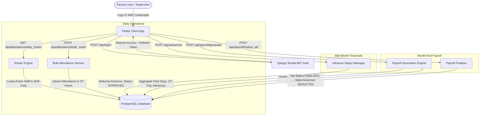
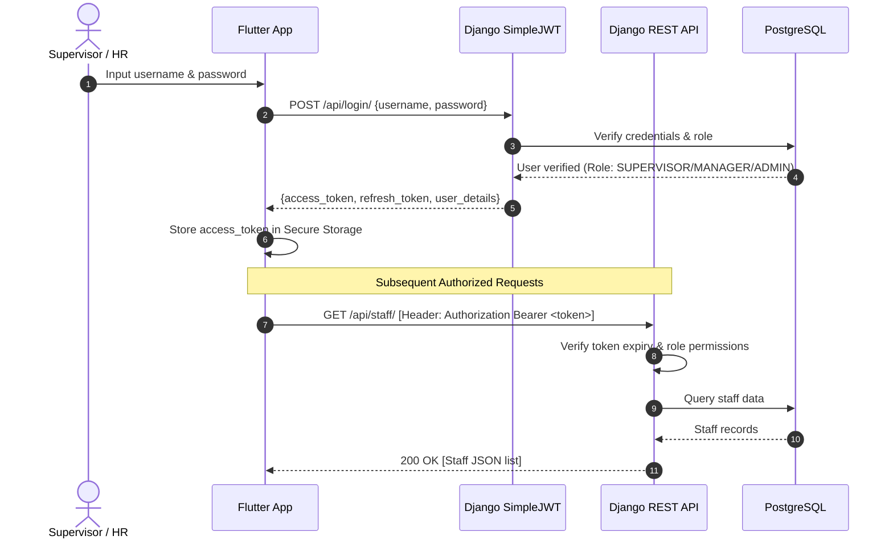
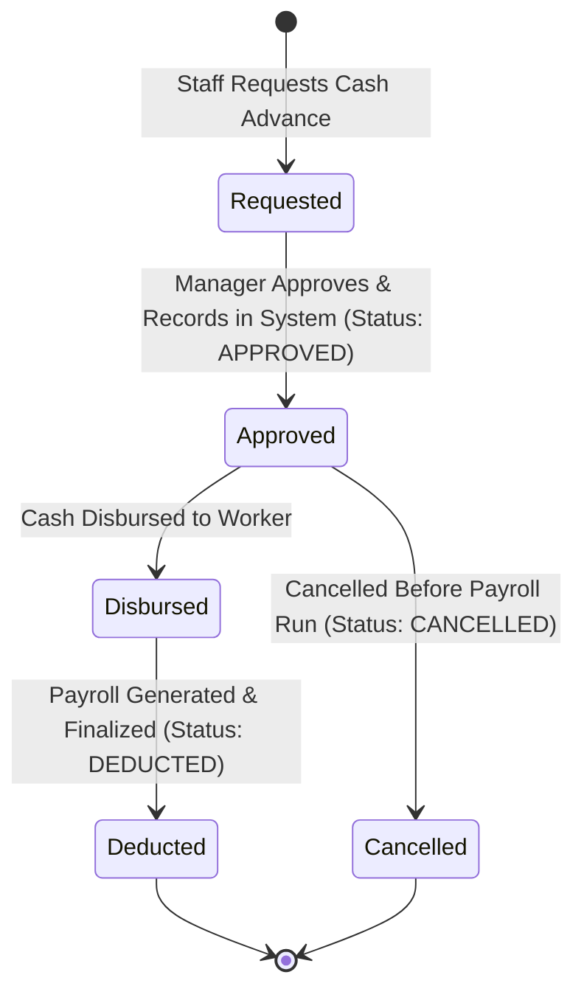
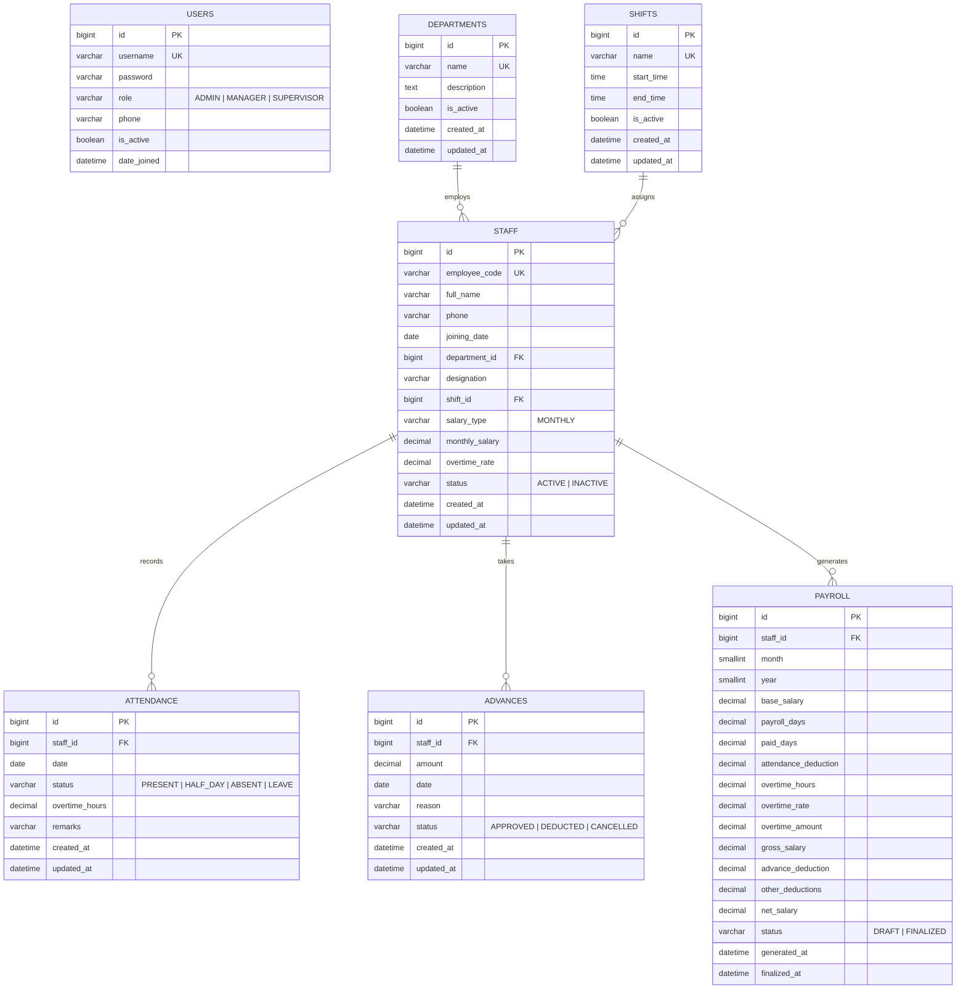

# SOFTWARE REQUIREMENTS SPECIFICATION (SRS)
## Sanitary & Ceramic Factory Workforce & Payroll Management System (SanitaryApp)
**Document Version:** 1.0.0  
**Status:** Approved / Engineering Specification  
**Backend Architecture:** Django & Django REST Framework (DRF) with PostgreSQL / SQLite  
**Client Architecture:** Flutter Cross-Platform (Desktop, Tablet, Mobile)  

---

## TABLE OF CONTENTS
1. [Introduction](#1-introduction)
   - 1.1 Purpose
   - 1.2 Scope of the System
   - 1.3 Definitions, Acronyms, and Abbreviations
   - 1.4 References
   - 1.5 System Overview
2. [Overall Description](#2-overall-description)
   - 2.1 Product Perspective & System Architecture
   - 2.2 User Classes and Characteristics
   - 2.3 Operating Environment
   - 2.4 Design and Implementation Constraints
   - 2.5 Assumptions and Dependencies
3. [System Architecture & Data Flows](#3-system-architecture--data-flows)
   - 3.1 High-Level Architecture Diagram
   - 3.2 Authentication & Authorization Workflow
   - 3.3 Daily Attendance & Overtime Processing Flow
   - 3.4 Advance Salary Lifecycle Flow
   - 3.5 Monthly Payroll Generation & Finalization Flow
4. [Backend Specification (Django REST Framework)](#4-backend-specification-django-rest-framework)
   - 4.1 Backend Project Structure
   - 4.2 Application Module Breakdown
   - 4.3 RESTful API Endpoints Specification
   - 4.4 Authentication & Security Architecture
5. [Database Schema Specification](#5-database-schema-specification)
   - 5.1 Entity-Relationship Diagram (ERD)
   - 5.2 Detailed Table DDL & Schema Definitions
   - 5.3 Business Integrity Constraints & Indexes
6. [System Features & Functional Requirements](#6-system-features--functional-requirements)
   - 6.1 User Authentication & Role-Based Access Control (RBAC)
   - 6.2 Department & Shift Management
   - 6.3 Staff Master Directory & Life Cycle
   - 6.4 Daily Roster & Bulk Attendance Operations
   - 6.5 Salary Advances & Loan Approvals
   - 6.6 Automated Payroll Computation Engine
   - 6.7 Executive Dashboard & KPIs
7. [Non-Functional Requirements](#7-non-functional-requirements)
   - 7.1 Performance Requirements
   - 7.2 Security & Data Privacy
   - 7.3 Reliability & Fault Tolerance
   - 7.4 Maintainability & Extensibility

---

## 1. INTRODUCTION

### 1.1 Purpose
This Software Requirements Specification (SRS) document details the complete functional and non-functional requirements for the **Sanitary & Ceramic Factory Workforce & Payroll Management System**. It specifies the business logic, API interface standards, Django backend architectural design, and relational database schema required to operate a reliable industrial attendance and payroll platform.

### 1.2 Scope of the System
The system is built specifically for industrial ceramic and sanitary manufacturing units. It automates:
- Real-time staff onboarding and profile lifecycle management.
- Multi-shift scheduling and department categorization.
- Daily attendance roster management with half-day and overtime tracking.
- Mid-month salary advances tracking and automatic deductions.
- Multi-tier monthly salary calculations taking into account dynamic attendance weights, overtime rates, and advance deductions.
- Real-time analytical KPI dashboards for factory administrative staff and supervisors.

### 1.3 Definitions, Acronyms, and Abbreviations
- **SRS**: Software Requirements Specification
- **DRF**: Django REST Framework
- **JWT**: JSON Web Token
- **RBAC**: Role-Based Access Control
- **ORM**: Object-Relational Mapping
- **KPI**: Key Performance Indicator
- **OT**: Overtime (recorded in hours)
- **ERP**: Enterprise Resource Planning

### 1.4 References
- IEEE Std 830-1998: IEEE Recommended Practice for Software Requirements Specifications.
- Django Documentation (v5.x): [https://docs.djangoproject.com/](https://docs.djangoproject.com/)
- Django REST Framework Documentation: [https://www.django-rest-framework.org/](https://www.django-rest-framework.org/)
- SimpleJWT Specification: [https://django-rest-framework-simplejwt.readthedocs.io/](https://django-rest-framework-simplejwt.readthedocs.io/)

---

## 2. OVERALL DESCRIPTION

### 2.1 Product Perspective & System Architecture
The platform is a decoupled, client-server enterprise solution:
- **Client (Frontend)**: Flutter application designed for tablet, desktop, and mobile devices deployed at factory shop floors, HR offices, and manager desks.
- **Backend Application Server**: Django REST Framework API server managing transactional security, calculations, and access control.
- **Database Layer**: Relational Database Management System (PostgreSQL in production, SQLite in local staging) preserving ACID integrity.

```
+-------------------------------------------------------------+
|             Client Layer: Flutter Enterprise App            |
|       (Shop Floor Supervisor / HR Manager / Factory Admin)   |
+-------------------------------------------------------------+
                              |
                     HTTPS / JSON REST
                              |
+-------------------------------------------------------------+
|               Django REST Framework API Gateway             |
|   [CORS] -> [JWT Auth Middleware] -> [Rate Limiter] -> [Views] |
+-------------------------------------------------------------+
       |             |              |            |          |
   [Accounts]   [Staff/Dept]   [Attendance]  [Advances]  [Payroll]
       +-------------+--------------+------------+----------+
                              |
                Django ORM (ACID Transactions)
                              |
+-------------------------------------------------------------+
|             Relational Database (PostgreSQL / SQLite)       |
+-------------------------------------------------------------+
```

### 2.2 User Classes and Characteristics
1. **Admin / Factory Owner**:
   - Access: Full privileges across all modules, configuration settings, user creation, payroll finalization, and audit reports.
2. **HR / Operations Manager**:
   - Access: Staff onboarding, department/shift configuration, advance approvals, draft payroll generation, and KPI inspections.
3. **Shop-Floor Supervisor**:
   - Access: View assigned departments/shifts, execute daily attendance rosters, submit overtime hours, and view daily presence statistics.

### 2.3 Operating Environment
- **Backend Runtime**: Python 3.10+ / Django 5.x.
- **WSGI / ASGI Server**: Gunicorn / Uvicorn behind Nginx reverse proxy.
- **Database Engine**: PostgreSQL 15+ (Production) / SQLite 3 (Development/Testing).
- **Client Platforms**: Windows 10/11, Android 10+, iOS 15+, and modern Web Browsers.

---

## 3. SYSTEM ARCHITECTURE & DATA FLOWS

### 3.1 High-Level Architecture Flowchart


### 3.2 Authentication & Authorization Workflow


### 3.3 Daily Attendance & Overtime Processing Flow
```mermaid
flowchart TD
    Start([Supervisor Opens Attendance]) --> SelectDate[Select Date & Filter Department]
    SelectDate --> FetchRoster[Fetch /api/attendance/daily_roster/]
    FetchRoster --> ShowList[Render Active Staff with Status & OT Controls]
    
    ShowList --> MarkStatus{Mark Status}
    MarkStatus -->|Present| P[Day Weight = 1.0]
    MarkStatus -->|Half Day| H[Day Weight = 0.5]
    MarkStatus -->|Absent / Leave| A[Day Weight = 0.0]
    
    P --> AddOT[Enter Overtime Hours (0 - 12 hrs)]
    H --> AddOT
    A --> SaveRemarks[Add Remarks if applicable]
    AddOT --> SaveRemarks
    
    SaveRemarks --> Submit[Submit Bulk Attendance]
    Submit --> API[POST /api/attendance/bulk_mark/]
    API --> Validate[Validate Shift & Overtime Constraints]
    Validate --> DB[(Save to Attendance Table with Unique Constraint)]
    DB --> Complete([Roster Updated & Attendance Summary Calculated])
```

### 3.4 Advance Salary Lifecycle Flow


### 3.5 Monthly Payroll Generation & Finalization Flow
```mermaid
flowchart TD
    Init([Manager Initiates Monthly Payroll]) --> InputParam[Select Month (1-12) & Year]
    InputParam --> TriggerGen[POST /api/payroll/generate/]
    
    subgraph Django Payroll Engine Calculation
        TriggerGen --> LoopStaff[Iterate Active Staff]
        LoopStaff --> CalcDays["Calculate Paid Days: SUM(Present=1.0, HalfDay=0.5)"]
        CalcDays --> CalcOT["Calculate OT Amount: SUM(OT_hours * Staff.overtime_rate)"]
        CalcOT --> CalcAdvances["Fetch Approved Advances for Selected Month"]
        CalcAdvances --> Formula["Base Payable = (BaseSalary / 30.0) * PaidDays<br>Gross = Base Payable + OT Amount<br>Net = Gross - AdvanceDeduction - OtherDeductions"]
        Formula --> SaveDraft[Create/Update Payroll Record as DRAFT]
    end
    
    SaveDraft --> Review[HR / Admin Reviews Draft Salaries & Summary]
    Review --> Approval{Approve All?}
    Approval -->|Adjustments Needed| EditDraft[Edit Individual Bonus/Deductions]
    EditDraft --> Review
    Approval -->|Confirmed| Finalize[POST /api/payroll/finalize_all/]
    Finalize --> Lock[Lock Payroll Status = FINALIZED]
    Lock --> UpdateAdv[Mark Associated Advances as DEDUCTED]
    UpdateAdv --> Done([Payslips Ready & Disbursed])
```

---

## 4. BACKEND SPECIFICATION (DJANGO REST FRAMEWORK)

### 4.1 Backend Project Structure
The backend is structured as an enterprise-grade Django project:
```
backend/
|-- manage.py
|-- config/
|   |-- __init__.py
|   |-- settings.py        # Database, JWT, CORS, Apps configuration
|   |-- urls.py            # Central API route dispatching
|   |-- wsgi.py
|   |-- asgi.py
|-- apps/
|   |-- core/              # TimeStampedModel, Custom Pagination, Exceptions
|   |-- accounts/          # Custom User model, Roles, Authentication views
|   |-- departments/       # Department master CRUD & stats
|   |-- shifts/            # Shift schedules and time windows
|   |-- staff/             # Staff models, filters, activation toggle
|   |-- attendance/        # Daily roster, bulk upsert, summary analytics
|   |-- advances/          # Salary advances workflow and balances
|   |-- payroll/           # Payroll generator, recalculation & finalizer
|   |-- dashboard/         # Aggregated KPI and executive reporting
```

### 4.2 Application Module Breakdown
| Module | Responsibility | Key Models |
| :--- | :--- | :--- |
| **`apps.accounts`** | Authentication, JWT token issuance, User role authorization | `User` (extends `AbstractUser`) |
| **`apps.departments`**| Factory division setup (e.g. Moulding, Kiln, Glazing, Packing) | `Department` |
| **`apps.shifts`** | Shift start/end timing management (Morning, Evening, Night) | `Shift` |
| **`apps.staff`** | Employee directory, base salary and OT rate configuration | `Staff` |
| **`apps.attendance`** | Daily presence marking, overtime calculations, daily rosters | `Attendance` |
| **`apps.advances`** | Advance loan registry, monthly tracking, status state machine | `AdvanceSalary` |
| **`apps.payroll`** | Formula-driven monthly payroll computation, locking payslips | `Payroll` |
| **`apps.dashboard`** | Analytical KPI summaries, monthly expenses, workforce charts | Computed views |

### 4.3 RESTful API Endpoints Specification

#### A. Authentication & Accounts (`/api/`)
| Method | Endpoint | Description | Role Allowed |
| :--- | :--- | :--- | :--- |
| `POST` | `/api/login/` | Authenticate with username & password; returns JWT pair | Public |
| `POST` | `/api/token/refresh/` | Obtain fresh access token via refresh token | Public |
| `GET` | `/api/me/` | Retrieve current authenticated user profile & role | Authenticated |
| `GET` | `/api/users/` | List all system users | Admin, Manager |
| `POST` | `/api/users/` | Create a new user (Supervisor / Manager) | Admin |
| `PUT` | `/api/users/{id}/` | Update user details and role | Admin |
| `DELETE`| `/api/users/{id}/` | Deactivate/remove system user | Admin |

#### B. Departments & Shifts (`/api/`)
| Method | Endpoint | Description | Role Allowed |
| :--- | :--- | :--- | :--- |
| `GET` | `/api/departments/` | List all departments | Supervisor, Manager, Admin |
| `POST` | `/api/departments/` | Create a new factory department | Manager, Admin |
| `PUT` | `/api/departments/{id}/` | Update department details | Manager, Admin |
| `GET` | `/api/shifts/` | List all active shift schedules | Supervisor, Manager, Admin |
| `POST` | `/api/shifts/` | Register a new shift schedule | Manager, Admin |
| `PUT` | `/api/shifts/{id}/` | Edit shift schedule | Manager, Admin |

#### C. Staff Management (`/api/`)
| Method | Endpoint | Description | Role Allowed |
| :--- | :--- | :--- | :--- |
| `GET` | `/api/staff/` | Search & filter staff list (query by status, dept, shift) | Authenticated |
| `POST` | `/api/staff/` | Onboard new factory worker | Manager, Admin |
| `GET` | `/api/staff/{id}/` | Get detailed worker profile & financial metadata | Authenticated |
| `PUT` | `/api/staff/{id}/` | Update employee profile, wage rates, or shift | Manager, Admin |
| `POST` | `/api/staff/{id}/activate/` | Mark inactive employee as ACTIVE | Manager, Admin |
| `POST` | `/api/staff/{id}/deactivate/` | Mark employee as INACTIVE (exclude from future rosters) | Manager, Admin |

#### D. Attendance & Roster Operations (`/api/`)
| Method | Endpoint | Description | Role Allowed |
| :--- | :--- | :--- | :--- |
| `GET` | `/api/attendance/daily_roster/?date=YYYY-MM-DD` | Returns roster of all active staff with marked status | Supervisor, Manager, Admin |
| `POST` | `/api/attendance/bulk_mark/` | Atomic bulk save/update of attendance & overtime | Supervisor, Manager, Admin |
| `GET` | `/api/attendance/summary/?date=YYYY-MM-DD` | Returns present, half-day, absent counts & total OT | Supervisor, Manager, Admin |
| `GET` | `/api/attendance/?staff={id}&month={m}&year={y}` | Filter attendance history by worker and month | Authenticated |

#### E. Advance Salary Module (`/api/`)
| Method | Endpoint | Description | Role Allowed |
| :--- | :--- | :--- | :--- |
| `GET` | `/api/advances/?staff={id}&month={m}&year={y}` | List advances filtered by status or worker | Manager, Admin |
| `POST` | `/api/advances/` | Disburse new advance (Staff, Amount, Date, Reason) | Manager, Admin |
| `GET` | `/api/advances/{id}/` | Retrieve advance record details | Manager, Admin |
| `PUT` | `/api/advances/{id}/` | Edit advance amount/reason before payroll finalization | Manager, Admin |
| `DELETE`| `/api/advances/{id}/` | Cancel/delete an advance | Admin |

#### F. Payroll Engine (`/api/`)
| Method | Endpoint | Description | Role Allowed |
| :--- | :--- | :--- | :--- |
| `GET` | `/api/payroll/?month={m}&year={y}` | List payroll records for month & year | Manager, Admin |
| `GET` | `/api/payroll/summary/?month={m}&year={y}` | Aggregated payroll summary (total net, gross, advances) | Manager, Admin |
| `POST` | `/api/payroll/generate/` | Trigger batch calculation for all active workers | Manager, Admin |
| `GET` | `/api/payroll/{id}/` | View individual payslip itemization | Manager, Admin |
| `POST` | `/api/payroll/{id}/finalize/` | Lock single payroll item to FINALIZED | Admin |
| `POST` | `/api/payroll/finalize_all/` | Batch lock all payroll items and mark advances deducted | Admin |

#### G. Executive Dashboard (`/api/`)
| Method | Endpoint | Description | Role Allowed |
| :--- | :--- | :--- | :--- |
| `GET` | `/api/dashboard/kpi/` | Returns real-time metrics: active staff, daily attendance, monthly expense | Manager, Admin |

---

## 5. DATABASE SCHEMA SPECIFICATION

### 5.1 Entity-Relationship Diagram (ERD)


### 5.2 Detailed Table DDL & Schema Definitions

#### 1. `users` (System Operator Accounts)
```sql
CREATE TABLE users (
    id BIGSERIAL PRIMARY KEY,
    username VARCHAR(150) NOT NULL UNIQUE,
    password VARCHAR(128) NOT NULL,
    first_name VARCHAR(150) NOT NULL DEFAULT '',
    last_name VARCHAR(150) NOT NULL DEFAULT '',
    email VARCHAR(254) NOT NULL DEFAULT '',
    role VARCHAR(20) NOT NULL DEFAULT 'SUPERVISOR' 
        CHECK (role IN ('ADMIN', 'MANAGER', 'SUPERVISOR')),
    phone VARCHAR(20) NOT NULL DEFAULT '',
    is_staff BOOLEAN NOT NULL DEFAULT FALSE,
    is_active BOOLEAN NOT NULL DEFAULT TRUE,
    date_joined TIMESTAMPTZ NOT NULL DEFAULT CURRENT_TIMESTAMP
);
```

#### 2. `departments` (Factory Departments)
```sql
CREATE TABLE departments (
    id BIGSERIAL PRIMARY KEY,
    name VARCHAR(100) NOT NULL UNIQUE,
    description TEXT NOT NULL DEFAULT '',
    is_active BOOLEAN NOT NULL DEFAULT TRUE,
    created_at TIMESTAMPTZ NOT NULL DEFAULT CURRENT_TIMESTAMP,
    updated_at TIMESTAMPTZ NOT NULL DEFAULT CURRENT_TIMESTAMP
);
```

#### 3. `shifts` (Work Schedules)
```sql
CREATE TABLE shifts (
    id BIGSERIAL PRIMARY KEY,
    name VARCHAR(50) NOT NULL UNIQUE,
    start_time TIME NOT NULL,
    end_time TIME NOT NULL,
    is_active BOOLEAN NOT NULL DEFAULT TRUE,
    created_at TIMESTAMPTZ NOT NULL DEFAULT CURRENT_TIMESTAMP,
    updated_at TIMESTAMPTZ NOT NULL DEFAULT CURRENT_TIMESTAMP
);
```

#### 4. `staff` (Worker Master Directory)
```sql
CREATE TABLE staff (
    id BIGSERIAL PRIMARY KEY,
    employee_code VARCHAR(30) NOT NULL UNIQUE,
    full_name VARCHAR(150) NOT NULL,
    phone VARCHAR(20) NOT NULL,
    joining_date DATE NOT NULL,
    department_id BIGINT NOT NULL REFERENCES departments(id) ON DELETE PROTECT,
    designation VARCHAR(100) NOT NULL,
    shift_id BIGINT NULL REFERENCES shifts(id) ON DELETE PROTECT,
    salary_type VARCHAR(20) NOT NULL DEFAULT 'MONTHLY' 
        CHECK (salary_type IN ('MONTHLY')),
    monthly_salary NUMERIC(12, 2) NOT NULL DEFAULT 0.00 
        CHECK (monthly_salary >= 0),
    overtime_rate NUMERIC(10, 2) NOT NULL DEFAULT 0.00 
        CHECK (overtime_rate >= 0),
    status VARCHAR(20) NOT NULL DEFAULT 'ACTIVE' 
        CHECK (status IN ('ACTIVE', 'INACTIVE')),
    created_at TIMESTAMPTZ NOT NULL DEFAULT CURRENT_TIMESTAMP,
    updated_at TIMESTAMPTZ NOT NULL DEFAULT CURRENT_TIMESTAMP
);

CREATE INDEX idx_staff_employee_code ON staff(employee_code);
CREATE INDEX idx_staff_status ON staff(status);
CREATE INDEX idx_staff_department ON staff(department_id);
```

#### 5. `attendance` (Daily Attendance & Overtime)
```sql
CREATE TABLE attendance (
    id BIGSERIAL PRIMARY KEY,
    staff_id BIGINT NOT NULL REFERENCES staff(id) ON DELETE PROTECT,
    date DATE NOT NULL,
    status VARCHAR(20) NOT NULL DEFAULT 'PRESENT' 
        CHECK (status IN ('PRESENT', 'HALF_DAY', 'ABSENT', 'LEAVE')),
    overtime_hours NUMERIC(4, 2) NOT NULL DEFAULT 0.00 
        CHECK (overtime_hours >= 0.00 AND overtime_hours <= 12.00),
    remarks VARCHAR(255) NOT NULL DEFAULT '',
    created_at TIMESTAMPTZ NOT NULL DEFAULT CURRENT_TIMESTAMP,
    updated_at TIMESTAMPTZ NOT NULL DEFAULT CURRENT_TIMESTAMP,
    
    CONSTRAINT unique_staff_date_attendance UNIQUE (staff_id, date)
);

CREATE INDEX idx_attendance_date ON attendance(date);
CREATE INDEX idx_attendance_staff_date ON attendance(staff_id, date);
```

#### 6. `advances` (Cash Advance Ledger)
```sql
CREATE TABLE advances (
    id BIGSERIAL PRIMARY KEY,
    staff_id BIGINT NOT NULL REFERENCES staff(id) ON DELETE PROTECT,
    amount NUMERIC(12, 2) NOT NULL 
        CHECK (amount > 0),
    date DATE NOT NULL,
    reason VARCHAR(255) NOT NULL DEFAULT '',
    status VARCHAR(20) NOT NULL DEFAULT 'APPROVED' 
        CHECK (status IN ('APPROVED', 'DEDUCTED', 'CANCELLED')),
    created_at TIMESTAMPTZ NOT NULL DEFAULT CURRENT_TIMESTAMP,
    updated_at TIMESTAMPTZ NOT NULL DEFAULT CURRENT_TIMESTAMP
);

CREATE INDEX idx_advances_staff ON advances(staff_id);
CREATE INDEX idx_advances_date ON advances(date);
CREATE INDEX idx_advances_status ON advances(status);
```

#### 7. `payroll` (Monthly Payroll Ledger)
```sql
CREATE TABLE payroll (
    id BIGSERIAL PRIMARY KEY,
    staff_id BIGINT NOT NULL REFERENCES staff(id) ON DELETE PROTECT,
    month SMALLINT NOT NULL 
        CHECK (month >= 1 AND month <= 12),
    year SMALLINT NOT NULL,
    base_salary NUMERIC(12, 2) NOT NULL 
        CHECK (base_salary >= 0),
    payroll_days NUMERIC(4, 2) NOT NULL DEFAULT 30.00,
    paid_days NUMERIC(4, 2) NOT NULL DEFAULT 0.00 
        CHECK (paid_days >= 0 AND paid_days <= 31),
    attendance_deduction NUMERIC(12, 2) NOT NULL DEFAULT 0.00,
    overtime_hours NUMERIC(6, 2) NOT NULL DEFAULT 0.00,
    overtime_rate NUMERIC(10, 2) NOT NULL DEFAULT 0.00,
    overtime_amount NUMERIC(12, 2) NOT NULL DEFAULT 0.00,
    gross_salary NUMERIC(12, 2) NOT NULL,
    advance_deduction NUMERIC(12, 2) NOT NULL DEFAULT 0.00,
    other_deductions NUMERIC(12, 2) NOT NULL DEFAULT 0.00,
    net_salary NUMERIC(12, 2) NOT NULL 
        CHECK (net_salary >= 0),
    status VARCHAR(20) NOT NULL DEFAULT 'DRAFT' 
        CHECK (status IN ('DRAFT', 'FINALIZED')),
    generated_at TIMESTAMPTZ NOT NULL DEFAULT CURRENT_TIMESTAMP,
    finalized_at TIMESTAMPTZ NULL,
    created_at TIMESTAMPTZ NOT NULL DEFAULT CURRENT_TIMESTAMP,
    updated_at TIMESTAMPTZ NOT NULL DEFAULT CURRENT_TIMESTAMP,
    
    CONSTRAINT unique_staff_month_year_payroll UNIQUE (staff_id, month, year)
);

CREATE INDEX idx_payroll_month_year ON payroll(month, year);
CREATE INDEX idx_payroll_staff_month ON payroll(staff_id, month, year);
CREATE INDEX idx_payroll_status ON payroll(status);
```

### 5.3 Business Integrity Constraints & Indexes
1. **Uniqueness**:
   - `users.username`: Unique.
   - `staff.employee_code`: Unique index for swift lookups.
   - `attendance(staff_id, date)`: Prevents duplicate attendance marking for any single date.
   - `payroll(staff_id, month, year)`: Ensures only a single payroll line item per staff member per calendar month.
2. **Referential Protection (`ON DELETE PROTECT`)**:
   - Deleting a department or shift with active employees is prohibited by foreign key constraints.
   - Deleting staff members who have historical attendance, advances, or payroll is blocked to preserve fiscal auditing.
3. **Range & Mathematical Sanity (`CHECK` Constraints)**:
   - `overtime_hours` constrained to `[0.00, 12.00]` hours per day.
   - `monthly_salary`, `overtime_rate`, and `net_salary` strictly non-negative.
   - `amount` in `AdvanceSalary` strictly greater than 0.

---

## 6. SYSTEM FEATURES & FUNCTIONAL REQUIREMENTS

### 6.1 User Authentication & Role-Based Access Control (RBAC)
- **FR-AUTH-1**: The system must authenticate users using JSON Web Tokens (access lifetime: 60 minutes, refresh lifetime: 7 days).
- **FR-AUTH-2**: Access to payroll finalization and user administration is restricted exclusively to users possessing the `ADMIN` role.
- **FR-AUTH-3**: Supervisors can mark attendance and view staff lists, but cannot view salary amounts or generate payroll.

### 6.2 Department & Shift Management
- **FR-DEPT-1**: Managers can create, update, and deactivate production departments.
- **FR-SHIFT-1**: The system supports multiple shifts (e.g., Morning: 08:00 - 16:30, Night: 20:00 - 04:30).
- **FR-SHIFT-2**: Each employee is assigned to a primary shift for roster filtering.

### 6.3 Staff Master Directory & Life Cycle
- **FR-STF-1**: Staff profiles capture: Employee Code, Full Name, Phone, Joining Date, Department, Designation, Shift, Monthly Salary, and Overtime Rate.
- **FR-STF-2**: Staff status can be transitioned between `ACTIVE` and `INACTIVE`. Inactive workers are excluded from future daily rosters and automatic payroll runs.

### 6.4 Daily Roster & Bulk Attendance Operations
- **FR-ATT-1**: Supervisors can fetch the daily roster for any chosen date. If not marked, records default to unmarked state.
- **FR-ATT-2**: Daily statuses comprise `PRESENT` (weight 1.0), `HALF_DAY` (weight 0.5), `ABSENT` (weight 0.0), and `LEAVE` (weight 0.0).
- **FR-ATT-3**: For workers working beyond regular shift hours, supervisors can input overtime hours up to a maximum of 12.00 hours.
- **FR-ATT-4**: Submission via `POST /api/attendance/bulk_mark/` must execute inside a Django database transaction (`transaction.atomic()`).

### 6.5 Salary Advances & Loan Approvals
- **FR-ADV-1**: Mid-month cash disbursements are recorded with staff reference, amount, date, and reason.
- **FR-ADV-2**: Advances start in `APPROVED` status.
- **FR-ADV-3**: During payroll calculation for month $M$, all `APPROVED` advances belonging to month $M$ are automatically aggregated into `advance_deduction`.
- **FR-ADV-4**: When payroll is finalized, these advances transition to `DEDUCTED` status.

### 6.6 Automated Payroll Computation Engine
- **FR-PAY-1**: Payroll can be generated in batch for a given month and year.
- **FR-PAY-2**: Mathematical Formulation:
  $$\text{Daily Wage} = \frac{\text{Base Salary}}{30.0}$$
  $$\text{Paid Days} = \sum \text{Present Days} + 0.5 \times \sum \text{Half Days}$$
  $$\text{Base Payable} = \text{Daily Wage} \times \text{Paid Days}$$
  $$\text{Overtime Amount} = \sum \text{Overtime Hours} \times \text{Overtime Rate}$$
  $$\text{Gross Salary} = \text{Base Payable} + \text{Overtime Amount}$$
  $$\text{Net Salary} = \max(0.00, \; \text{Gross Salary} - \text{Advance Deduction} - \text{Other Deductions})$$
- **FR-PAY-3**: Payroll records are initially generated in `DRAFT` status to allow HR adjustments.
- **FR-PAY-4**: On confirmation, `finalize_all` locks the payroll records as `FINALIZED` and prevents further edits or duplicate generation.

### 6.7 Executive Dashboard & KPIs
- **FR-DASH-1**: Real-time KPI cards display:
  - Active Staff Headcount.
  - Today's Present / Half-Day / Absent counts.
  - Current Month's Projected Payroll Expense.
  - Total Unsettled Advances for the Month.

---

## 7. NON-FUNCTIONAL REQUIREMENTS

### 7.1 Performance Requirements
- **NFR-PERF-1**: Daily roster loading for up to 500 factory workers must respond in under **350 ms**.
- **NFR-PERF-2**: Bulk attendance submission for up to 500 workers must commit in under **1000 ms**.
- **NFR-PERF-3**: Full factory monthly payroll generation must complete within **3.0 seconds**.

### 7.2 Security & Data Privacy
- **NFR-SEC-1**: All network traffic between Flutter clients and the Django backend must use TLS 1.3 / HTTPS.
- **NFR-SEC-2**: User passwords hashed using PBKDF2 with SHA-256 (Django default).
- **NFR-SEC-3**: Cross-Origin Resource Sharing (CORS) configured with explicit allowed origins.
- **NFR-SEC-4**: Financial fields (salaries, advances) are masked from supervisors and only exposed to authenticated Managers and Admins.

### 7.3 Reliability & Fault Tolerance
- **NFR-REL-1**: Bulk attendance operations use database transactions (`@transaction.atomic`); partial failures will roll back completely.
- **NFR-REL-2**: Database daily automated snapshots and WAL (Write-Ahead Logging) archiving.

### 7.4 Maintainability & Extensibility
- **NFR-MNT-1**: Clean app-level separation in Django (`apps.staff`, `apps.attendance`, etc.).
- **NFR-MNT-2**: Riverpod providers and repository pattern on the Flutter client ensuring decoupled UI and business logic.
